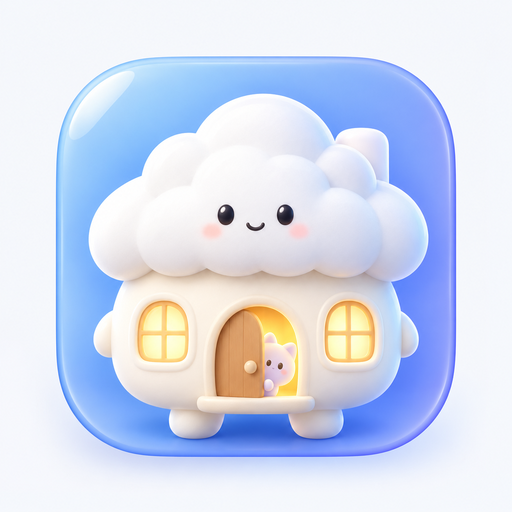

<div align="center">



# Dollhouse

Android 桌宠应用，把悬浮人偶、聊天和记忆管理放在一起。

[](https://github.com/Farewell-coder/Dollhouse/releases/latest)
[](#安装)
[](LICENSE)

[](https://github.com/Farewell-coder/Dollhouse/releases/latest)
[](README.en.md)

</div>

---

当前人偶是鲸鱼娘「小肥鱼」。她会眨眼、待机摆动、贴边探头；可以拖动，点击弹出台词气泡，三击唤出迷你输入框。在其他应用上也能发起聊天，需要查看历史时再进入完整聊天界面。

## 功能

- **人偶互动**：拖动、贴边吸附、位置保存、大小调整和动画。
- **聊天**：多轮对话、流式回复、会话历史；迷你框与完整聊天界面共用会话。AI 对话需自行配置联网服务，不内置离线模型。
- **记忆**：会话自动总结、长期记忆自动保存、记忆自动精简是三个独立开关；记忆库主视图为**力导向图谱**，可拖拽、缩放、点节点看详情、点连线看关系，也可手动为记忆建立关联。
- **提供商与模型**：管理多套服务配置、模型列表与收藏。实际协议、流式与工具调用兼容性取决于所用服务。
- **外观**：跟随系统、浅色、深色、纯黑主题；壁纸取色、人偶大小、背景图与毛玻璃。背景分**人偶层 / 全局层**两级回落，可为单个人偶单独设置聊天背景与气泡颜色。壁纸取色不可用时回退内置配色。
- **我的资料**：聊天列表左上角头像进入，可设置自己的头像、昵称与个性签名。
- **图片处理**：背景裁剪与文字识别，OCR 使用 Google ML Kit。
- **可选设备操作**：通过 Shizuku 提供系统命令能力；安装并启动 lamda 后可扩展点按、滑动、输入、打开应用和读取界面等操作。无需这些组件也能使用桌宠及已配置的聊天。
- **后台运行**：前台服务、开机恢复和保活设置用于提高存活率，仍受系统省电与后台策略影响。
- **诊断中心**：关于页最后一项进入。查看真实错误与崩溃分组、异常堆栈和关联日志，搜索筛选记录，执行日志自检，读取系统提供的进程退出原因，并导出经过完整性校验的 ZIP 诊断包。严重错误始终保留基础记录，详细运行日志可单独开关。

## 安装

1. 在 [Releases](https://github.com/Farewell-coder/Dollhouse/releases) 下载 APK，允许安装未知来源应用。
2. 打开应用，授予悬浮窗权限并启动桌宠；通知权限用于显示运行通知。
3. 如需聊天，在设置中填写自己的服务配置；如后台经常被关闭，可按设置引导调整电池优化和厂商自启动选项。

最低 Android 7.0（API 24），目标 Android 14（API 34）。已在 OPPO / ColorOS 14 构建和装机验证，不代表所有厂商和系统均已验证。

设备操作需要自行安装、启动并授权 [Shizuku](https://github.com/RikkaApps/Shizuku)。[lamda](https://github.com/firerpa/lamda) 是可选的外部组件，不随 APK 分发；当前下载包约 204 MB，下载后还需在应用中解包并启动，以实际提示为准。第三方组件遵循其自身条款。

## 权限与数据

- 悬浮窗用于人偶及聊天窗口；前台服务和通知用于后台运行；开机广播用于恢复人偶；电池优化白名单为可选项。
- 网络权限用于配置的对话服务、联网工具和可选组件下载；震动权限用于触摸反馈。图片通过系统选择器选取。
- 对话、记忆和配置保存在本机应用私有目录。联网聊天时，相关对话、记忆以及工具结果会按功能需要发送给所配置的服务；凭据用于请求认证。导出或分享配置前请检查是否含敏感信息。
- ML Kit 及其 Google 依赖适用各自条款和数据处理规则，不能据此承诺应用完全不联网或不产生 SDK 诊断数据。
- 授权后的设备命令可能读取界面、文件和设置，也可能修改设备状态。模型生成的指令可能出错，不应把工具输出或权限授权视为安全保证。

## 更新公告

各版本的新功能、改进与修复内容不再在此罗列，统一收录于更新记录，欢迎前往查看。

更新公告详见 [更新记录](CHANGELOG.md)。

## 构建

需要 JDK 17、Android SDK 36；工程使用 Gradle 8.11.1、AGP 8.9.1、Kotlin 2.2.10。源码为纯 Kotlin，无 Java 源文件。

```bash
git clone https://github.com/Farewell-coder/Dollhouse.git
cd Dollhouse
# 在 local.properties 中配置本机 SDK 路径。
# gradle.properties 含手机 arm64 构建的本地 aapt2 路径；
# 普通桌面环境须移除该覆盖项，或改成可用的本机路径。
./gradlew assembleDebug
```

发布签名请参照 `keystore.properties.example` 配置自己的密钥，再运行 `./gradlew assembleRelease`。产物在 `app/build/outputs/apk/`。签名凭据和构建产物不入库；自行签名的包不能直接覆盖官方签名包。

## 第三方声明

| 来源 | 用途 | 许可或条款 |
| --- | --- | --- |
| [Lucide](https://github.com/lucide-icons/lucide) | 图标路径的 Android 适配 | ISC，Feather 衍生部分为 MIT |
| [Shizuku API](https://github.com/RikkaApps/Shizuku-API) | 授权与系统接口客户端 | MIT；不等同于独立管理器的许可 |
| Kotlin、协程、Hilt / Dagger、AndroidX 等 | 运行时及依赖 | Apache-2.0 等，逐项见清单 |
| Google ML Kit / Play services | 文字识别及其依赖 | Google ML Kit / Android SDK 条款，适用独立第三方条款 |

完整版权、许可及构建依赖清单见 [第三方声明](THIRD_PARTY_NOTICES.md) 和 [licenses](licenses/)。

## 许可与免责声明

Dollhouse 自有代码采用 [GPL-3.0](LICENSE)，Copyright (C) 2026 Farewell-coder；第三方内容遵循各自许可。移植和适配记录见第三方声明与更新记录。

本项目按“现状”提供，不保证适配所有设备。AI 回复及设备操作可能出错，重要信息和高权限操作请自行核实。此说明不减少适用开源许可赋予的权利，也不排除法律规定不可免除的责任。